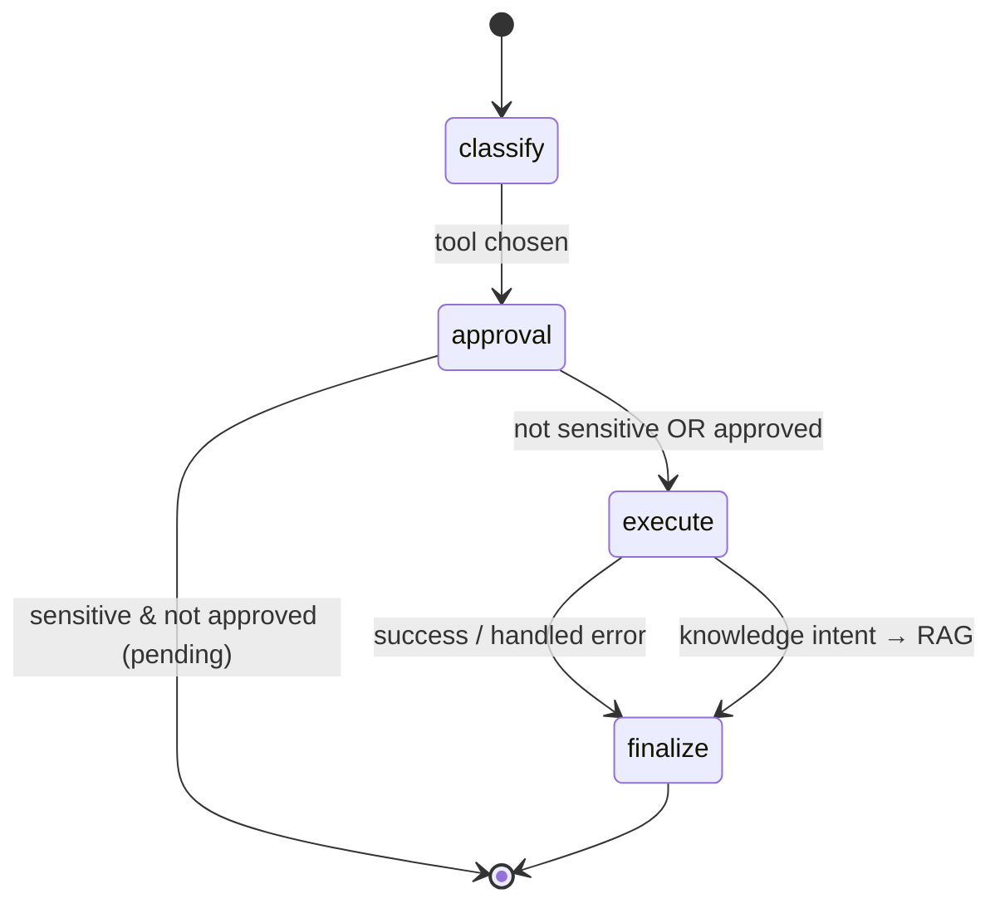

# Agents & LangGraph

## Agent vs. deterministic workflow

- A **deterministic workflow** runs a fixed sequence of steps (e.g. always: retrieve →
  generate). It's cheaper, predictable, and easier to test. Use it when you know the steps.
  Implemented in `Agent.run_deterministic` (`app/agents/graph.py`).
- An **agentic workflow** lets the model/router *choose* among approved tools based on
  intent. Use it when the path depends on the input. Implemented in `Agent.run`.

**Rule of thumb for interviews**: prefer a fixed workflow unless the task genuinely needs
dynamic tool selection — agents add latency, cost, and failure surface (loops, wrong tools).

## State machine (nodes, edges, state)

We model the agent as an explicit state machine — the same mental model as LangGraph. If
`langgraph` is installed, `app/mcp`/agent code can be adapted to a compiled graph; the
dependency-free version always runs so the demo never breaks.

**Typed state** (`AgentState` in `app/agents/graph.py`): `question`, `tenant`, `intent`,
`tool_name`, `tool_args`, `tool_result`, `steps`, `errors`, `pending_approval`, `approved`,
`final_answer`, `done`.

**Nodes**:
- `classify` — intent routing (ticket lookup/create, calculation, structured SQL, knowledge).
- `check_approval` — approval gate for sensitive (write) tools.
- `execute` — run the tool with **bounded retries** and validated inputs.
- `finalize` — synthesize the answer (RAG for knowledge intent; summarize tool results
  otherwise).

**Edges/routing** are driven by `intent` and the approval flag. **Bounds**:
`AGENT_MAX_STEPS` and `AGENT_MAX_RETRIES` prevent infinite loops and runaway retries.

## Tools (safe by design)

`app/agents/tools.py`. Every tool has a Pydantic `InputModel` (validated before execution).

| Tool | Safety |
|------|--------|
| `calculator` | Safe AST evaluator — **no `eval`** of arbitrary code |
| `knowledge_base_search` | Tenant-scoped retrieval only |
| `sql_query` | **Read-only, allowlisted** SELECT; blocks stacked statements and DDL/DML |
| `ticket_lookup` | Read-only mock |
| `ticket_create` | **Write — requires explicit approval** |

The SQL allowlist (`validate_select`) ensures the LLM can never run arbitrary SQL. The agent
never executes shell commands or LLM-generated code.

## Human-in-the-loop approval

Sensitive tools set `requires_approval=True`. The agent stops at `check_approval` and returns
`pending_approval=True` with a message. Re-running with `approved=True` executes the action.
This is how you gate destructive/irreversible operations.

## Preventing unnecessary tool calls & loops

- Intent routing picks **one** tool per turn for the demo (no open-ended loop).
- `AGENT_MAX_STEPS` caps total steps; `AGENT_MAX_RETRIES` caps per-tool retries.
- Knowledge questions bypass tools and go straight to grounded RAG.

## Where to look

- Orchestration & nodes: `app/agents/graph.py`
- Tools & schemas: `app/agents/tools.py`
- API: `app/api/v1/agents.py` (`GET /api/v1/agent/tools`, `POST /api/v1/agent/run`)
- Tests: `tests/test_phase5_agents.py`
