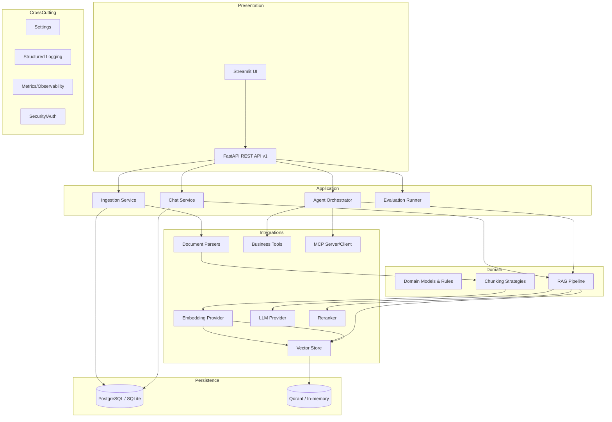
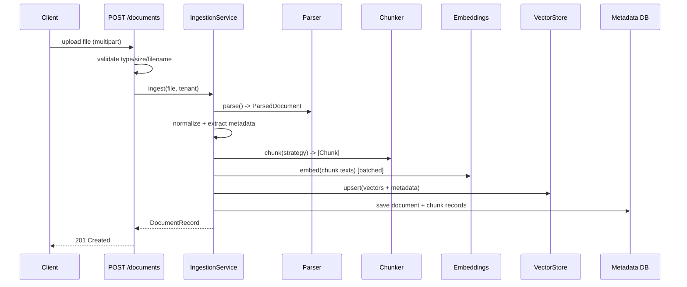
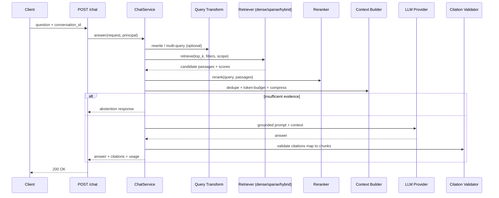
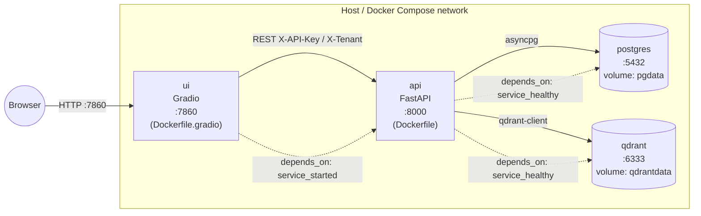

# Architecture — Enterprise AI Knowledge Copilot

## 1. High-level overview

## 2. Layering

1. **API & presentation** (`app/api`, `ui/`): HTTP endpoints, request/response schemas,
   Gradio demo. No business logic here.
2. **Application services** (`app/services`): orchestrate use-cases (ingest a document,
   answer a chat turn). Transaction boundaries and DI live here.
3. **Domain** (`app/domain`, `app/chunking`, `app/rag`): framework-free models and rules.
4. **Integrations** (`app/parsers`, `app/embeddings`, `app/llm`, `app/vectorstore`,
   `app/retrieval`, `app/agents`, `app/mcp`): adapters behind typed interfaces.
5. **Persistence** (`app/persistence`): SQLAlchemy models + repositories.
6. **Cross-cutting** (`app/config.py`, `app/logging_config.py`, `app/observability`,
   `app/core/security.py`): configuration, logging, metrics, auth.

Dependencies point **inward**: integrations depend on domain interfaces, not vice versa.
Providers are selected via **factories** driven by `Settings`, enabling mock ↔ real swaps.

## 3. Document ingestion lifecycle

## 4. RAG query lifecycle

## 5. Agent state graph

See `docs/AGENTS_AND_LANGGRAPH.md` for the full node/edge description. The agent is a
bounded state machine: classify → retrieve → decide tool → (tool | answer) → validate,
with max-step and retry limits and an approval gate for sensitive (write) tools.

## 6. Data flow & trust boundaries

- **Uploaded documents are untrusted.** They are parsed and treated as data; any
  instructions embedded in them are *not* executed. Prompt-injection defenses wrap
  retrieved context (delimiters + system guardrails) — see `docs/SECURITY.md`.
- **Tool inputs/outputs are validated** with Pydantic schemas. SQL is allowlisted and
  parameterized; the LLM never executes arbitrary SQL/shell/code.
- **Tenant scope** is attached to every stored chunk and enforced at retrieval time.

## 7. Configuration-driven provider selection

| Concern | Mock (default) | Real (opt-in via env) |
|--------|----------------|----------------------|
| LLM | `MockLLM` (deterministic) | OpenAI-compatible `/chat/completions` |
| Embeddings | `MockEmbeddings` (hashed, deterministic) | OpenAI-compatible `/embeddings` |
| Vector store | In-memory | Qdrant |
| Metadata DB | SQLite | PostgreSQL |

`APP_MODE=mock` (default) guarantees no external calls. `APP_MODE=real` requires valid
credentials and documents which env vars are needed.

## 8. Deployment topology (Docker Compose)

Four services run as independent containers so the UI and API can scale separately. The
API talks to Postgres (metadata) and Qdrant (vectors); the Gradio UI talks only to the API
over HTTP. Dependencies are gated by healthchecks.

| Service | Build | Port | Depends on |
|---------|-------|------|-----------|
| `ui` | `Dockerfile.gradio` | 7860 | `api` (started) |
| `api` | `Dockerfile` | 8000 | `postgres`, `qdrant` (healthy) |
| `postgres` | `postgres:16-alpine` | 5432 | — |
| `qdrant` | `qdrant/qdrant:v1.12.1` | 6333 | — |

