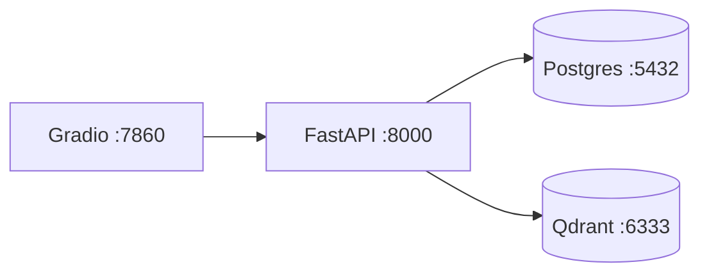

# Deployment

## Local (no Docker)

```powershell
poetry install --with dev
poetry run uvicorn app.main:app --reload       # http://localhost:8000/docs
```

Default config: mock mode, SQLite at `./data/copilot.db`, in-memory vector store. No external
services required.

## Docker Compose (API + UI + Postgres + Qdrant)

```powershell
copy .env.example .env
docker compose up --build
```

Services & ports:

| Service | Image | Port | Notes |
|---------|-------|------|-------|
| api | built from `Dockerfile` | 8000 | FastAPI; non-root user; healthcheck on `/health` |
| ui | built from `Dockerfile.gradio` | 7860 | Gradio |
| postgres | `postgres:16-alpine` | 5432 | volume `pgdata` |
| qdrant | `qdrant/qdrant:v1.12.1` | 6333 | volume `qdrantdata` |

In Compose the API uses `DATABASE_URL=postgresql+asyncpg://...` and `VECTOR_STORE=qdrant`
(set in `docker-compose.yml`). Dependencies use healthchecks with `depends_on: condition:
service_healthy`.



## Operational commands

| Action | Command |
|--------|---------|
| Initial setup | `copy .env.example .env` |
| Start | `docker compose up --build` |
| Migrations | Schema auto-created on startup (demo). Production: add Alembic (see ADR 0002) |
| Load sample docs | `python -m scripts.load_sample_docs --url http://localhost:8000` |
| Run tests | `pytest` |
| Run evaluation | `python -m scripts.run_eval` |
| API docs | open `http://localhost:8000/docs` |
| Stop | `docker compose down` |
| Reset demo data safely | `docker compose down -v` (drops volumes) |

## Migrations

The demo creates tables via SQLAlchemy `metadata.create_all` on startup (`init_db`). For
production use **Alembic**: generate versioned migrations and run them in an init container or
entrypoint before the API starts. SQLite is used locally; Postgres in Docker (ADR 0002).

## Real provider mode

Set in `.env`: `APP_MODE=real`, `OPENAI_API_KEY`, optionally `OPENAI_BASE_URL`, `LLM_MODEL`,
`EMBEDDING_MODEL`, `EMBEDDING_DIM`. The app fails fast if credentials are missing.

> ⚠️ Changing `EMBEDDING_MODEL`/`EMBEDDING_DIM` invalidates existing vectors — re-ingest or
> re-embed. See `docs/RAG_DEEP_DIVE.md`.

## CI/CD

`.github/workflows/ci.yml` runs on push/PR: install pinned deps → Ruff lint + format check →
mypy (advisory) → pytest with coverage → `pip-audit` → Docker image builds. Real-model tests
are **opt-in** (no keys in CI).

## Verification status

- Tests + lint + eval: verified in this environment.
- Docker build / `compose up`: **not executed here** (engine present). Configuration is
  complete; run the commands above to verify in your environment.
