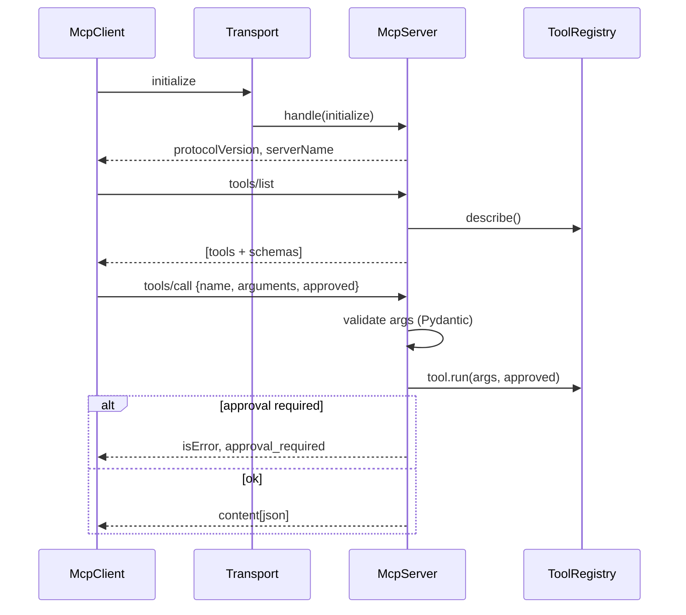

# MCP Guide (Model Context Protocol)

## What MCP is (and isn't)

- **Function calling** is the *model-facing* mechanism: the LLM emits a structured request to
  call a named tool with JSON arguments. It lives inside one application/provider.
- **MCP** is a *protocol* that standardizes how any compatible **client** discovers and
  invokes **tools/resources** exposed by a **server**, across process/transport boundaries.
  Think "USB-C for tools": one client can talk to many tool servers.

So: function calling decides *that* a tool should run; MCP standardizes *how* clients and
tool servers discover each other and communicate.

## Our implementation

Code: `app/mcp/server.py`, `app/mcp/client.py`. Tests: `tests/test_phase6_mcp.py`.

We expose the existing `ToolRegistry` through an MCP-style JSON-RPC surface:

- `initialize` → protocol/version handshake.
- `tools/list` → returns each tool's `name`, `description`, and **JSON input schema**
  (discovery).
- `tools/call` → **validates arguments** against the schema, executes, and returns a
  structured result or error (including an `approval_required` signal for write tools).

### Request lifecycle

### Transports

- **In-process** (`InProcessTransport`) — default; used by tests and the in-app agent. No
  subprocess, but the exact same request/response lifecycle.
- **stdio** (`serve_stdio`, optional) — a real MCP server using the official `mcp` Python
  SDK. Run with `poetry install --extras mcp; poetry run python -m scripts.run_mcp_server`. Prefer stdio for local
  development (no network exposure).

## Security boundaries

- **Schema validation** happens on the server before any tool runs.
- **Allowlisting & approval** are enforced inside the tools themselves (e.g. read-only SQL,
  `ticket_create` approval), so they hold regardless of transport.
- If you expose MCP over **HTTP** instead of stdio, you must add authentication (e.g. bearer
  tokens), TLS, and network restrictions — stdio avoids this by keeping the server local to
  the client process tree.

## Interview talking points

- Discovery contract = tool name + description + JSON schema.
- MCP decouples tool providers from tool consumers (agents), enabling reuse across apps.
- The same safety rules (validation, allowlists, approvals) must live on the **server** side,
  because clients are untrusted.
